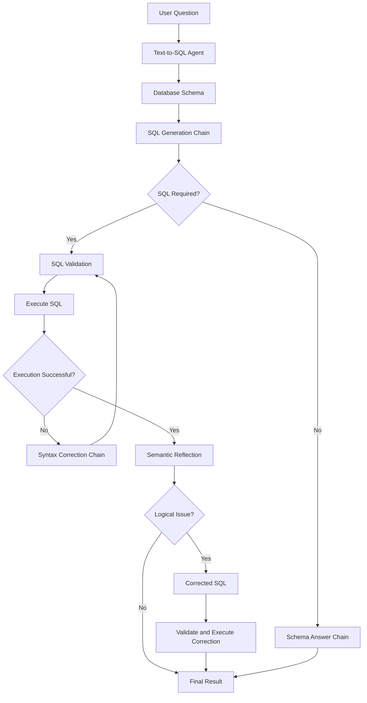

# Text-to-SQL AI Agent with Self-Correction

An LLM-powered Text-to-SQL agent that converts natural language questions into SQLite queries, executes them, detects SQL errors, and performs semantic validation to improve query correctness.

The project demonstrates how to build a practical AI agent using **Python, LangChain, OpenRouter, and SQLite**, with support for both English and Persian questions.

---

## Overview

This project allows users to interact with a relational database using natural language instead of writing SQL manually.

The agent follows a multi-step workflow:

1. Understands the user's natural language question.
2. Retrieves the database schema and generates a SQLite query.
3. Executes the generated query against the database.
4. Detects and attempts to fix SQL execution errors.
5. Evaluates whether the query logically answers the original question.
6. Generates a corrected query when a semantic issue is detected.
7. Returns the final result.

It also supports schema-based questions that do not require SQL execution.

## Architecture



## Key Features

- **Natural Language to SQL:** Converts user questions into SQLite queries.
- **Persian and English Support:** Accepts questions in both languages.
- **Schema Awareness:** Uses database schema information to generate relevant queries.
- **Automatic Syntax Correction:** Attempts to fix SQL execution errors, with a configurable retry limit.
- **Semantic Validation:** Reviews generated SQL for logical issues involving JOINs, filters, aggregations, and missing conditions.
- **Semantic Correction:** Generates a corrected query when a logical problem is detected.
- **Schema-Based Responses:** Answers questions about available database tables without executing SQL.
- **OpenRouter Integration:** Uses OpenRouter as an API gateway to access supported LLMs.
- **Evaluation Dataset:** Includes nine predefined questions covering different database operations.
- **Text Output:** Supports saving execution logs and evaluation results to a text file.

## Technology Stack

| Technology | Purpose |
|---|---|
| Python 3.12 | Main programming language |
| LangChain | LLM orchestration and LCEL chains |
| OpenRouter | LLM API gateway |
| ChatOpenAI | OpenAI-compatible model integration |
| SQLite | Relational database |
| SQLAlchemy | Database connectivity |
| python-dotenv | Environment variable management |

## Project Structure

```text
text-to-sql-agent/
│
├── main.py                  # Main Text-to-SQL agent
├── create_table.py          # Database and table initialization
├── bank_database.db         # SQLite database (generated locally)
├── .env                     # API credentials (not committed)
├── .env.example             # Environment configuration template
├── .gitignore
├── requirements.txt
├── results.txt              # Evaluation output (generated)
└── README.md
```

## Database Schema

The project uses a sample banking database containing four main tables:

| Table | Description |
|---|---|
| `Customer` | Customer information |
| `Account` | Bank account details and balances |
| `Transaction` | Deposits, withdrawals, fees, and other transactions |
| `Transfer` | Money transfers between accounts or customers |

The agent retrieves schema information dynamically using LangChain's `SQLDatabase` utility.

## Agent Workflow

### 1. SQL Generation

The SQL generation chain receives the user question and database schema, then generates a SQLite `SELECT` query.

For questions that can be answered directly from the schema, it returns `NO_SQL`.

### 2. Schema-Based Answering

If SQL is not required, a separate chain generates an answer using the database schema.

### 3. SQL Execution and Syntax Correction

The generated query is validated and executed.

If execution fails, the syntax correction chain receives:

- Original question
- Failed SQL query
- Database error message
- Database schema

It attempts to generate a corrected query.

The default maximum number of syntax-generation attempts is three.

### 4. Semantic Reflection

After successful execution, the semantic reflection chain evaluates whether the query correctly answers the original question.

It checks:

- JOIN conditions
- Filtering conditions
- Aggregation logic
- Missing conditions
- Logical consistency

If a problem is identified, the chain generates a corrected query, which is validated and executed.

**Note:** Semantic correction is currently a single correction step, not an unlimited retry loop.

## Installation

### Prerequisites

- Python 3.10 or newer
- pip
- An OpenRouter API key

### 1. Clone the repository

```bash
git clone <YOUR_REPOSITORY_URL>
cd text-to-sql-agent
```

### 2. Create a virtual environment

```bash
python3.12 -m venv venv
```

Activate it:

**macOS / Linux**

```bash
source venv/bin/activate
```

**Windows**

```powershell
venv\Scripts\activate
```

### 3. Install dependencies

```bash
pip install -r requirements.txt
```

Example `requirements.txt`:

```text
langchain
langchain-core
langchain-community
langchain-openai
SQLAlchemy
python-dotenv
```

### 4. Configure OpenRouter

Create a `.env` file in the project root:

```dotenv
OPENROUTER_API_KEY=your_openrouter_api_key
OPENROUTER_MODEL=openai/gpt-4o-mini
```

Replace the API key with your actual OpenRouter key.

The model identifier is configurable and must be supported by OpenRouter.

Get your API key from:

https://openrouter.ai/keys

### 5. Initialize the database

If the database has not been created yet, run:

```bash
python create_table.py
```

This should create the SQLite database and populate the sample banking tables according to your database initialization script.

### 6. Run the agent

```bash
python main.py
```

To save both standard output and errors:

```bash
python main.py > output.txt 2>&1
```

To display output in the terminal while saving it:

```bash
python main.py 2>&1 | tee output.txt
```

## Evaluation

The project includes nine predefined evaluation questions covering different database scenarios.

| # | Evaluation Scenario |
|---|---|
| 1 | Identify available database tables and data |
| 2 | Retrieve customers registered after a specified date |
| 3 | List active bank accounts and their balances |
| 4 | Identify customers with inactive accounts |
| 5 | Find the customer with the largest single transaction |
| 6 | Calculate total deposits for a specific account |
| 7 | Find accounts whose transactions are exclusively withdrawals |
| 8 | Rank customers by total transaction volume |
| 9 | Identify customers appearing as both transfer senders and recipients |

These scenarios test schema awareness, filtering, aggregation, joins, subqueries, and semantic validation.

### Expected Reference Results

The following are reference values for validating the sample database:

| Scenario | Expected Result |
|---|---|
| Customers registered after 2021-01-01 | 4 customers |
| Active bank accounts | 10 accounts |
| Customers with inactive accounts | Hossein Rashidi, Reza Karimi |
| Largest single transaction | Ali Rezaei — 1841.01 |
| Total deposits for ACC200001 | 1540.09 |
| Withdrawal-only account | ACC400001 |
| Customers in both transfer roles | Mohammad Khan, Reza Karimi |

For the customer transaction-volume ranking, the reference order is:

1. Ali Rezaei — 6431.29
2. Sara Ahmadi — 5120.27
3. Reza Karimi — 3827.55
4. Mohammad Khan — 2337.67
5. Fatemeh Esfahani — 1523.40
6. Hossein Rashidi — 1255.00
7. Neda — 888.71
8. Maryam Hosseini — 712.09

These values should be checked against the initialized database when reproducing the evaluation.

## Security Considerations

This project is an educational and experimental implementation, not a production-ready banking system.

Important considerations:

- Never commit `.env` or expose API credentials.
- Use read-only database permissions for query execution.
- The current SQL validation helper is a basic guard, not a complete SQL security mechanism.
- Use a proper SQL parser or AST-based validation for stronger query restrictions.
- Avoid sending sensitive customer information to external LLM providers.
- Consider token limits, API costs, rate limits, and model availability.
- For financial applications, use appropriate decimal or integer-based monetary representations rather than floating-point values.

## Future Improvements

- Implement structured LLM output validation using Pydantic.
- Add robust SQL parsing and read-only execution enforcement.
- Introduce configurable semantic correction retries.
- Add automated unit and integration tests.
- Support PostgreSQL and other relational databases.
- Add query execution timeouts and result-size limits.
- Introduce conversation memory for multi-turn database interactions.
- Build a REST API using FastAPI.
- Add observability, tracing, and token/cost monitoring.
- Evaluate SQL accuracy using a larger benchmark dataset.

## Author

**Akbar Mohammadi**

Senior DevOps Engineer | SRE | Platform Engineering | AI Infrastructure

- GitHub: [akbarmohammadi70](https://github.com/akbarmohammadi70)
- LinkedIn: [Akbar Mohammadi](https://www.linkedin.com/in/akbar-mohammadi-12741616b/)

---

If you find this project useful, feel free to ⭐ the repository.

